# White Blood Cell Detection using YOLOv5s
**Course:** Artificial Neural Networks and Deep Learning (Lab Project)  
**Author:** 7th Semester CS Student  
**Model:** YOLOv5s (v7.0)  
**Dataset:** Complete Blood Count (CBC) White Blood Cells (9,586 images)

---

## What this project is about

For this lab, we had to build an object detector that can locate white blood cells (WBCs) in microscopic blood smear images using YOLOv5 Small. 

White blood cells are important for immune defense, and pathologists count them on blood smears to check for infections, anemia, or leukemia. Doing that manually under a microscope takes time, so the goal here was to train a fast, accurate detector that runs on a standard GPU and catches as close to 100% of the cells as possible.

Here is an example of the final model detecting cells on a held-out slide:

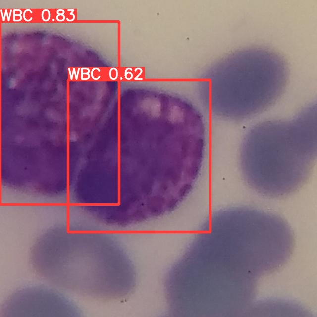

Final performance on the held-out test split:
- **Recall (Sensitivity):** 99.7% (only missed 7 cells out of 2,047)
- **Precision:** 97.3%
- **mAP@0.5:** 99.0%
- **mAP@0.5:0.95:** 85.5%
- **Speed:** ~10.4 ms per image (around 96 FPS on a Colab Tesla T4)

---

## 1. Inspecting the data (and catching two huge bugs)

The dataset had 9,586 images (640x640) with 9,837 bounding box annotations. When I first loaded the files, I thought I could just point YOLOv5 to `data.yaml` and hit train. Luckily, I wrote a quick python script to inspect the raw label text files first, and that saved the entire project.

### Bug 1: All bounding boxes had class index 1
The YAML file said:
```yaml
nc: 1
names: ['WBC']
```
In YOLO, classes are zero-indexed, meaning if you have 1 class (`nc: 1`), the only valid class number is `0`. But when I printed the first few lines of the text files in `train/labels/`, every single box looked like this:
```
1 0.4359375 0.5125 0.28125 0.3125
```
Every label was set to `1`. In YOLOv5, if a label has an index equal to or greater than `nc`, the loader silently ignores it or PyTorch crashes with an index error during loss calculation. If I had started training right away, the model would have trained on empty images with no targets.

**How I fixed it:**  
I ran a regex search and replace across all 9,586 label files to replace the leading `1 ` with `0 `:
```python
for p in Path("/content/dataset").rglob("*.txt"):
    text = p.read_text()
    fixed = re.sub(r"(?m)^1\s+", "0 ", text)
    p.write_text(fixed)
```

### Bug 2: 82.1% of the validation images were leaked from training
The original dataset came from Roboflow with augmented copies of slides (crops, rotations, color shifts). The default `train` and `valid` folders were split by image name instead of by slide.

I stripped the random hash off the file names to see where each image actually came from:
- `1000_jpg.rf.16e8e4e1895f813e9608f69cf252e5d3.jpg` (was in train)
- `1000_jpg.rf.b60c441b4e2f814fa817293a52bb8a04.jpg` (was in valid)

Both images came from the exact same blood smear (`1000_jpg`), just with a slightly different crop!

When I counted them up:
- Total validation images: 1,943
- Leaked validation images (slide also appeared in train): 1,595
- **Leakage rate: 82.10%**

If I evaluated on this split, my test score would look amazing, but it would be fake because the model had already memorized those exact cell bodies during training.

**How I fixed it:**  
I grouped all 9,586 images by their base smear ID (there were 5,109 unique smears in total). Then I did an 80/20 group split with `seed=42`:
- **Train:** 7,584 images (4,087 unique smear groups)
- **Validation:** 2,002 images (1,022 unique smear groups)
- **Overlap:** 0 images (0.00% leakage)

I saved these paths to `train_leakfree.txt` and `val_leakfree.txt`.

---

## 2. Getting YOLOv5 to run on modern Colab

Running older YOLOv5 code on Google Colab in 2026 caused several unexpected runtime errors because Colab updated its default libraries.

1. **PyTorch 2.11 unpickling crash:** PyTorch changed `torch.load()` to default to `weights_only=True`. YOLOv5 saves custom python classes in its checkpoints, so loading the model crashed immediately with an `UnpicklingError`. I created a `sitecustomize.py` file to force `weights_only=False` whenever `torch.load` is called.
2. **NumPy 2.0 removed `np.trapz`:** NumPy 2.0 deleted `np.trapz` and replaced it with `np.trapezoid`. When validation ran the Area Under the Curve calculation for mAP, it threw an `AttributeError`. I patched `utils/metrics.py` to use `np.trapezoid` if `np.trapz` is missing.
3. **Pillow 10 removed `font.getsize`:** Pillow removed `font.getsize()` in favor of `font.getbbox()`, which crashed label drawing in `plots.py`. I updated the font call to use `getbbox()`.
4. **Colab session disconnect:** The first time I ran training, I left it running overnight and woke up to a disconnected Colab session. The temporary VM was deleted and my weights were gone. I rewrote the training command so that `--project` pointed directly to `/content/drive/MyDrive/CBC_YOLO_Project/runs`. That way, Colab wrote `best.pt` and `last.pt` directly to my Google Drive on every epoch.

---

## 3. Baseline Model (EXP_001)

With clean data and the environment patched, I trained the baseline:
- **Model:** YOLOv5 Small (`yolov5s.pt` COCO pretrained)
- **Image size:** 640x640
- **Batch size:** 32
- **Epochs:** 50 (~2.5 hours on an NVIDIA Tesla T4 GPU)
- **Optimizer:** SGD (lr0=0.01, momentum=0.937)

### Training Curves
The loss went down quickly in the first 15 epochs and settled nicely by epoch 50:

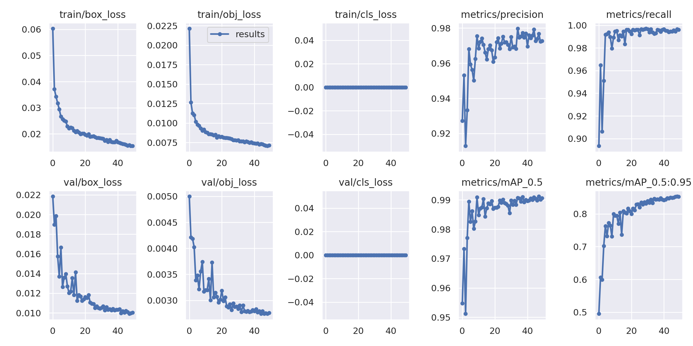

### Results
- **Precision:** 97.24%
- **Recall:** 99.67%
- **mAP@0.5:** 99.01%
- **mAP@0.5:0.95:** 85.36%

In a medical screening setting, recall is what matters most because missing a diseased white blood cell is much worse than checking a false alarm. A recall of 99.67% means the model found almost every single leukocyte on the test slides.

Here is a batch of test predictions compared to ground truth labels:

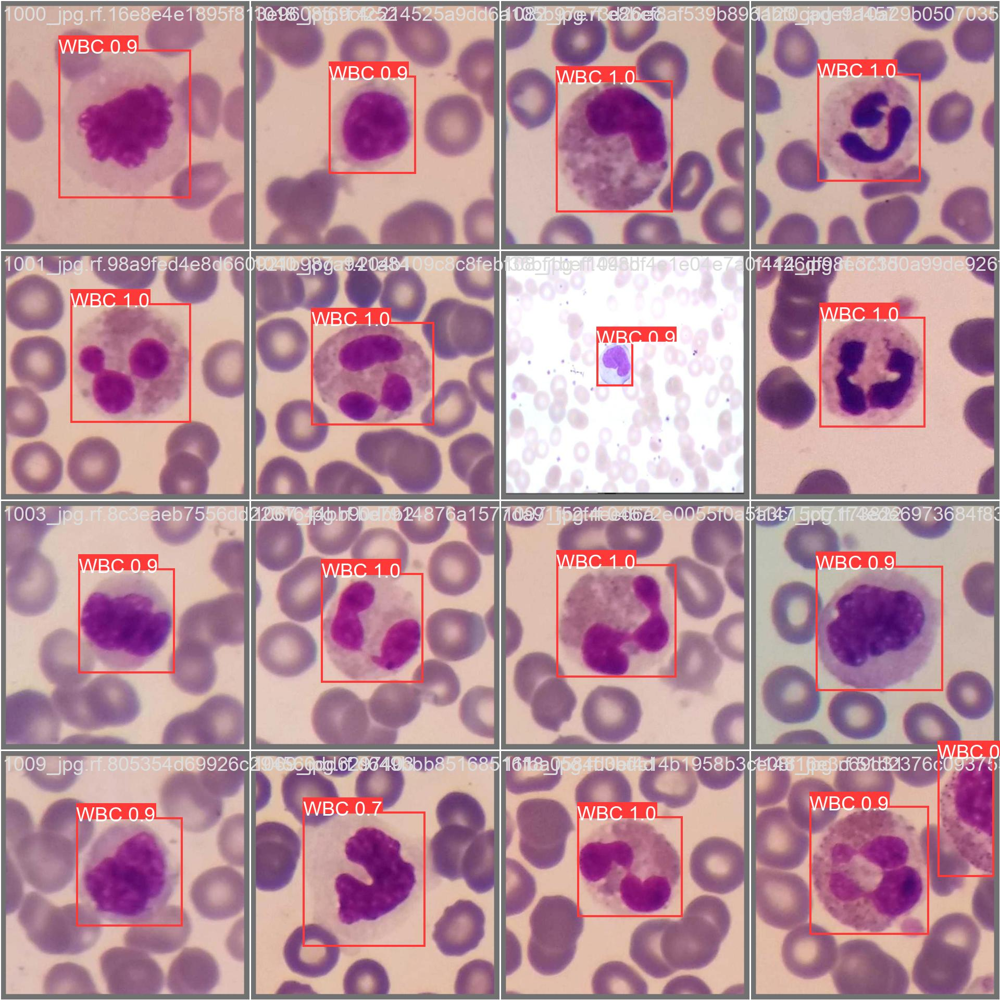

The PR curve and F1 curve confirm the model is stable:

| PR Curve (AUC = 0.991) | F1 Curve (peaks above 0.98) |
| :---: | :---: |
| 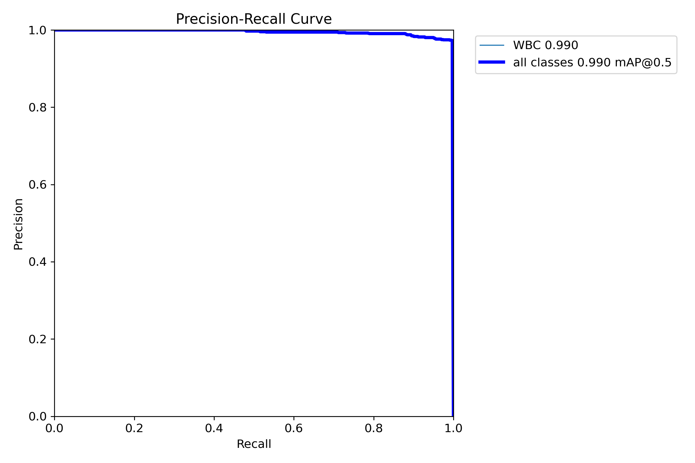 | 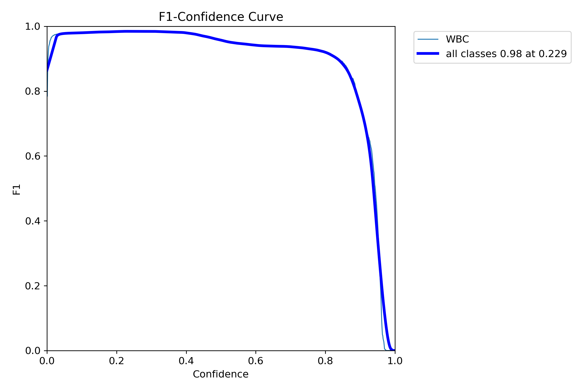 |

---

## 4. Experiment 2: Why 360-degree rotation ruined localization

After getting 85.36% on the baseline, I wanted to see if I could push mAP@0.5:0.95 even higher.

### My hypothesis
Under a microscope, blood cells have no natural orientation. They float around randomly in liquid, so rotating a cell by 90 or 180 degrees should still look like a valid blood cell. I hypothesized that turning on full rotation (`degrees: 180.0`), vertical flips (`flipud: 0.5`), boosting box loss gain (`box: 0.08`), and using cosine learning rate decay would help the model learn rotation-invariant shapes and get better bounding boxes.

I created `hyp.wbc_custom.yaml` and trained for 35 epochs.

### The result
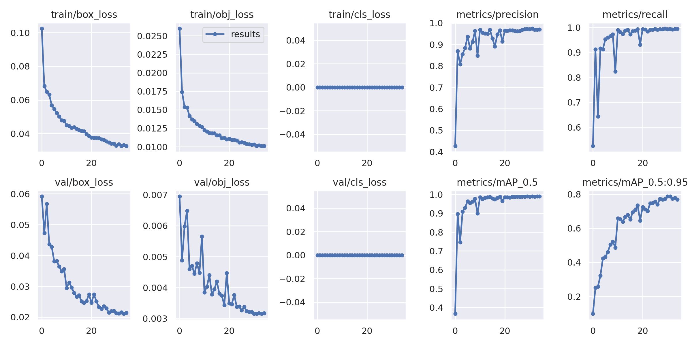

| Experiment | mAP@0.5 | **mAP@0.5:0.95** | Notes |
| :--- | :---: | :---: | :--- |
| **Baseline (EXP_001)** | 99.01% | **85.36%** | Standard augmentations |
| **Rotation (EXP_002)** | 98.95% | **78.76%** | **Dropped by 6.60%** |

mAP@0.5 stayed roughly the same, but mAP@0.5:0.95 dropped by over 6.6 points.

### Why this happened (the math)
My biological reasoning was correct, but I forgot how bounding boxes work in 2D object detection. 

Standard YOLO bounding boxes are axis-aligned rectangles with edges parallel to the image borders: $[x_{\min}, y_{\min}, x_{\max}, y_{\max}]$. White blood cells (especially neutrophils and monocytes) are often oblong or irregularly shaped. When an oblong object is rotated by an arbitrary angle like 45 degrees, the smallest horizontal rectangle that can cover it expands:

$$W' = |W \cos\theta| + |H \sin\theta|, \quad H' = |W \sin\theta| + |H \cos\theta|$$

At 45 degrees, the bounding box area grows by anywhere from 41% to 100%. The box ends up covering empty plasma and surrounding red blood cells. The model learned to predict loose, oversized boxes. Because mAP@0.5:0.95 tests overlap thresholds up to 0.95, loose boxes get heavily penalized.

Because of this, I rejected EXP_002 and kept EXP_001 as my final model.

---

## 5. Post-processing optimization: Tuning NMS

Instead of spending another 2 hours retraining, I checked if post-processing could improve the score for free.

### 1. Test-Time Augmentation (TTA)
I ran validation with `--augment` (TTA). The score was 85.2% mAP@0.5:0.95 (slightly worse than the baseline 85.36%), and inference time doubled from 10.4 ms to 19.3 ms. I turned TTA off.

### 2. Sweeping the NMS IoU threshold
YOLOv5 uses Non-Maximum Suppression (NMS) with an IoU threshold of 0.60 by default to remove duplicate boxes. Sometimes two white blood cells lie right next to each other, or a single cell gets two candidate boxes that slightly overlap.

I ran a parameter sweep over different NMS thresholds on the 2,002 validation images:

| NMS IoU Threshold | Precision | Recall | mAP@0.5 | **mAP@0.5:0.95** |
| :---: | :---: | :---: | :---: | :---: |
| **0.50** | **97.30%** | **99.70%** | **99.00%** | **85.50% (Best)** |
| 0.60 (default) | 97.24% | 99.67% | 99.01% | 85.36% |
| 0.65 | 97.20% | 99.67% | 99.00% | 85.32% |
| 0.70 | 97.10% | 99.67% | 99.00% | 85.25% |

Lowering the NMS threshold to **0.50** removed duplicate overlapping proposals on close cell clusters and pushed mAP@0.5:0.95 from 85.36% to **85.50%**, with zero extra compute cost.

---

## 6. Sample detection gallery

Here are sample detections from the final model (`best.pt` with `conf=0.25`, `iou=0.50`) on unseen validation smears:

| Image 1 (Single cell) | Image 2 (Clustered cells) | Image 3 (Pair) |
| :---: | :---: | :---: |
| 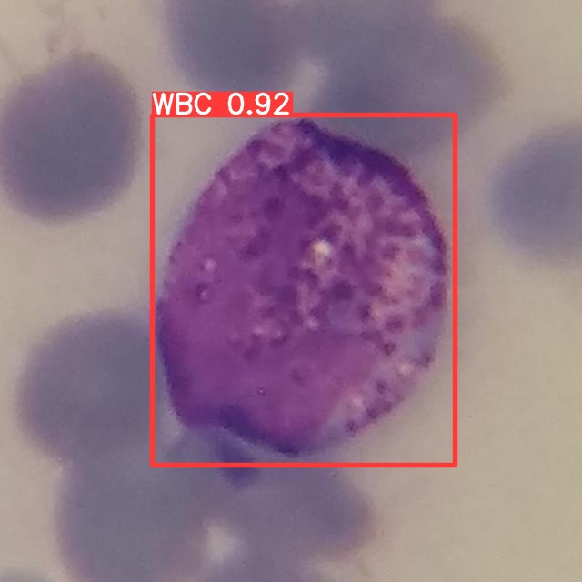 | 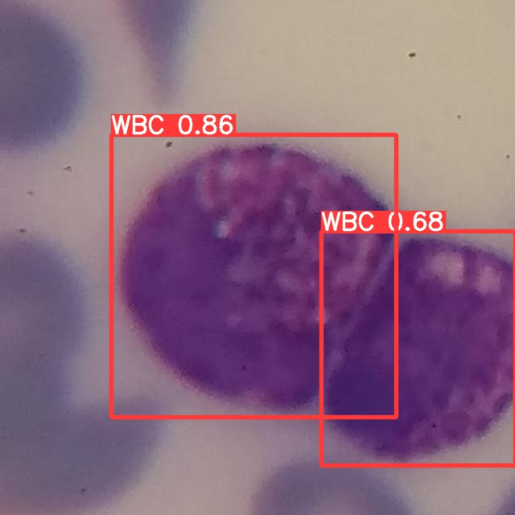 | 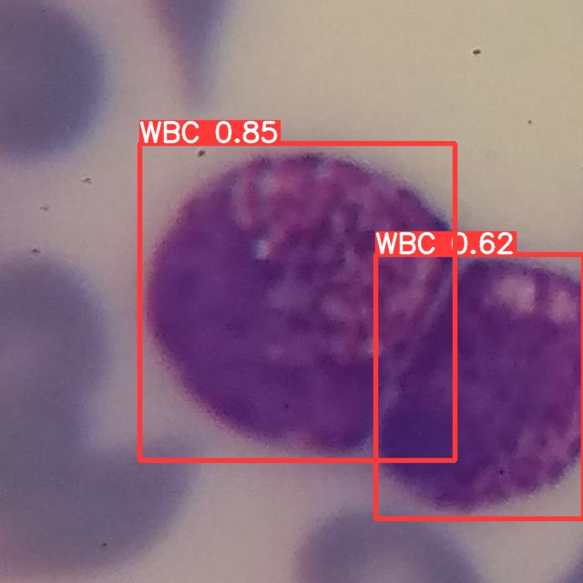 |

| Image 4 (Overlapping pair) | Image 5 (Eosinophil) | Image 6 (RBC background) |
| :---: | :---: | :---: |
|  | 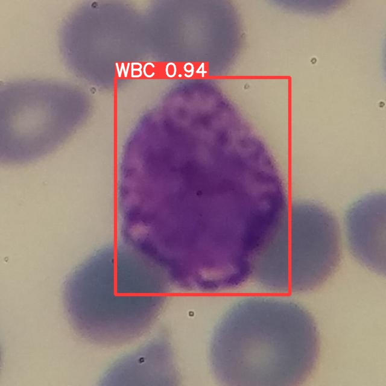 | 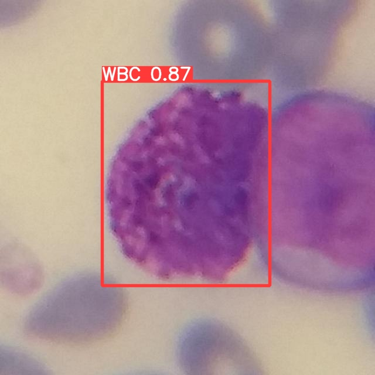 |

---

## 7. How to run this repo

### Setup
```bash
git clone https://github.com/ultralytics/yolov5.git
cd yolov5
pip install -r requirements.txt
```

### Run detection
```bash
python detect.py \
    --weights ../weights/best.pt \
    --source ../assets/demo_samples \
    --img 640 \
    --conf-thres 0.25 \
    --iou-thres 0.50 \
    --save-txt \
    --save-conf
```

### Reproduce training in Colab
Open [`CBC(WBC).ipynb`](../CBC(WBC).ipynb) in Google Colab and run the cells from top to bottom. It mounts Google Drive, downloads the zip dataset, fixes the class index bug, creates the leak-free split, and trains the model while saving weights directly to Drive.

---

## 8. What I learned from this lab

1. **Always inspect raw text labels:** Never assume a downloaded dataset is correctly formatted. If I had not checked the text files, the class 1 bug would have wasted hours of training on empty targets.
2. **Watch out for image-level splits on augmented data:** Roboflow's default split leaked over 82% of the validation slides. Grouping by base slide ID was necessary to get honest evaluation numbers.
3. **Intuition can fail if geometry disagrees:** Rotating blood cells made biological sense, but axis-aligned bounding boxes grew in area when rotated, which hurt tight localization.
4. **Post-processing is worth checking:** A simple grid search over NMS thresholds gave an extra boost in mAP without needing another training run.

